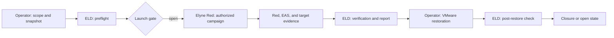

# Elyne Lab Director — public architecture

**English · [Français](architecture.md)**

ELD directs the laboratory workflow. It prepares and follows a campaign, tracks evidence, and produces a report. Elyne Red selects and executes offensive actions within an approved scenario; ELD governs laboratory stages and recovery gates. **EAS Defense**, **Elyne Red Unified**, and **ELD** therefore retain distinct roles.

A deterministic path is available. A local model may assist analysis or propose stages without replacing the manifest, scope checks, stop control, or operator attestation. In the encrypted VMware laboratory, restoring a snapshot requires a human click; ELD must then inspect the actual state before reaching a conclusion.

A generated journal or report is not itself a defense verdict. See [evidence and limits](evidence.en.md).
