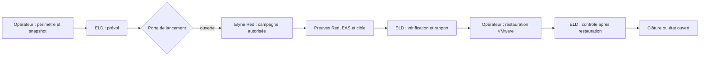

# Elyne Lab Director — architecture publique

**Français · [English](architecture.en.md)**

ELD est le directeur du laboratoire. Il prépare et suit une campagne, tient les preuves et produit un rapport. Elyne Red choisit puis exécute les actions offensives dans un scénario approuvé ; ELD contrôle les étapes du laboratoire et leurs portes de reprise. Les trois produits **EAS Défense**, **Elyne Red Unifiée** et **ELD** conservent donc des rôles distincts.

Un parcours déterministe est possible. Un modèle local peut assister l'analyse ou la proposition d'étapes, sans remplacer le manifeste, les contrôles de périmètre, le verrou d'arrêt et l'attestation de l'opérateur. Avec la VM VMware chiffrée du laboratoire, la restauration du snapshot demande un clic humain ; ELD doit ensuite constater l'état réel avant de conclure.

Un journal ou un rapport généré n'est pas, en soi, un verdict de défense. Voir [preuves et limites](evidence.md).
